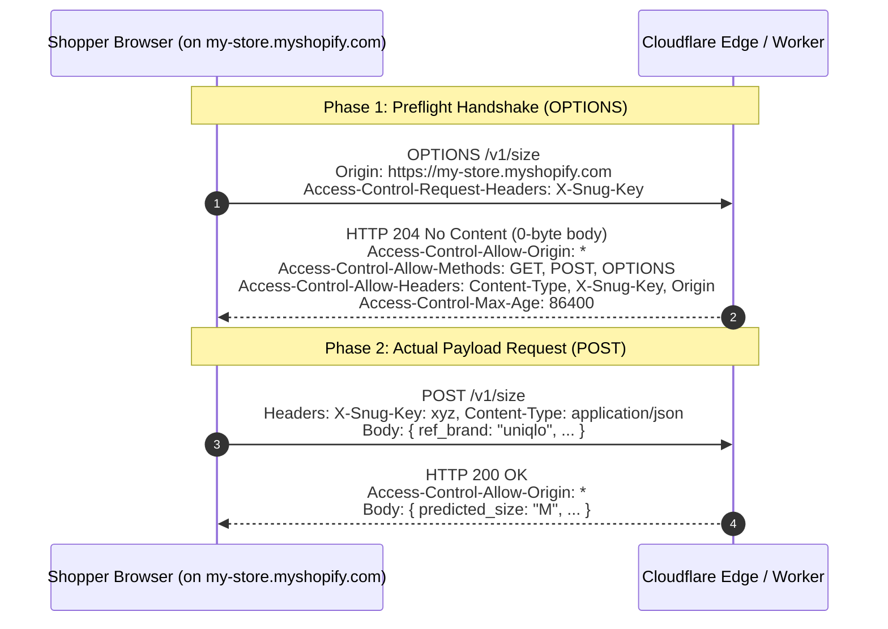

# Module 01: CORS Protocol Mechanics, CDN Edge Caching & Preflight Optimization

---

## 1. First-Principles Concept: The Same-Origin Policy & CORS

### What is the Same-Origin Policy (SOP)?
The **Same-Origin Policy** is a fundamental browser security mechanism. A web page loaded from one origin (e.g. `https://my-store.myshopify.com`) is restricted by the browser from making read requests to a different origin (e.g. `https://api.snug.app`).

Two URLs share the **same origin** if and only if their **scheme (protocol)**, **host (domain)**, and **port** are identical:
- `https://my-store.myshopify.com:443/products` ↔ `https://my-store.myshopify.com:443/cart` → **Same Origin**
- `https://my-store.myshopify.com` ↔ `https://api.snug.app` → **Cross-Origin**

### How Cross-Origin Resource Sharing (CORS) Solves This
CORS is a W3C standard protocol that uses HTTP headers to tell browsers that a server running at `https://api.snug.app` grants permission to web applications running on storefront domains to access its resources.

---

## 2. The 2-Phase Browser CORS Handshake

When a browser script sends a "non-simple" cross-origin HTTP request (e.g., a `POST` request carrying a custom header like `X-Snug-Key`), the browser enforces a **two-phase handshake**:



### Critical Rule: Why CORS Headers Must Exist on BOTH Phases
1. **Phase 1 (Preflight)**: The browser checks whether the server *allows the request to be sent*.
2. **Phase 2 (Actual Payload)**: The browser receives the `POST` response. It **inspects the response headers again** for `Access-Control-Allow-Origin`.
   > **Warning**: If `Access-Control-Allow-Origin` is present on the `OPTIONS` preflight response but missing on the `POST` response, **the browser will block the storefront JavaScript from reading the JSON body**, resulting in a CORS client-side error.

---

## 3. Deep Dive into Implementation Questions

### Q1: Why use an empty `204 No Content` response instead of returning a standard response body (like JSON or text) for preflights?

- **HTTP 204 No Content Specification**: Section 6.3.5 of RFC 7231 specifies that an HTTP 204 response **must not contain any message body**.
- **Metadata-Only Handshake**: Preflight `OPTIONS` requests are strictly metadata queries where the browser checks server capabilities before sending actual payloads. Browsers completely ignore response bodies on preflights. Helper functions that attach a body (such as `c.json()`, `c.text()`, or `c.html()`) force the server to allocate memory, format data, set `Content-Type` headers, and serialize non-zero bytes over the network unnecessarily.
- **Protocol Compliance & Performance**: Returning `new Response(null, { status: 204, headers: corsHeaders })` guarantees a **0-byte payload**, strict adherence to RFC 7231 standards, and zero network serialization overhead.

### Q2: Why store `corsHeaders` as a `Record<string, string>` instead of a `Map` or a custom Interface?

- **Runtime JavaScript Reality**: At runtime in JavaScript, `Record<string, string>` **is a plain object (`{}`)**. There is no special "Record" class in JavaScript; TypeScript simply uses `Record<K, V>` as a utility shorthand for `{ [key: string]: string }`.
- **Web Standard Fetch API Compatibility (Map Incompatibility)**: The global `Response` constructor in the Web Standard Fetch API (`new Response(body, { headers })`) accepts a plain object (`Record<string, string>`) or a native `Headers` instance. **It does NOT accept a JavaScript `Map`!** Passing a `Map` (`new Map(...)`) to `new Response(...)` causes the Fetch API runtime to ignore the headers or throw a `TypeError`.
- **Zero Conversion Overhead**: Storing headers in a `Map` would require calling `Object.fromEntries(myMap)` to convert it into a plain object on every single request, wasting CPU cycles and memory allocations.
- **TypeScript Type Widening**: Writing `: Record<string, string>` explicitly tells TypeScript: *"Treat this plain object as a dynamic dictionary of generic string keys and values"*. Without this annotation, TypeScript infers a narrow object type with only specific literal keys, causing type mismatch errors when calling `ctx.res.headers.set(key, value)`.

### Q3: Why is static `Access-Control-Allow-Origin: *` highly cacheable at the CDN Edge?

#### Static `*` vs Dynamic Origin Reflection

- **Static `Access-Control-Allow-Origin: *`**:
  The response to `OPTIONS /v1/size` is **100% identical** regardless of whether the preflight came from `store-a.com`, `store-b.com`, or `store-z.com`.
  Cloudflare CDN Points of Presence (POPs) around the world cache this single `OPTIONS` 204 response in edge RAM. When any shopper on any store triggers a preflight, Cloudflare's CDN edge answers the preflight in **< 5ms** — **without executing our Cloudflare Worker script isolate or using CPU time!**

- **Dynamic Origin Reflection (`Access-Control-Allow-Origin: https://store-a.com`)**:
  The preflight response differs per domain (`store-a.com` vs `store-b.com`). The CDN cannot serve a single universal cached answer unless it stores millions of separate origin entries (`Vary: Origin`), forcing many preflights to pass through to the Worker script isolate.

By using static `*` for CORS preflights and pairing it with application-level `Origin` validation in `authMiddleware`, we achieve **blazing fast CDN preflights** + **strict domain security**.

---

## 4. Final Annotated Implementation of `worker/src/middleware/cors.ts`

```typescript
import { createMiddleware } from "hono/factory";

// Standard CORS headers object adhering to Record<string, string> shape
const corsHeaders: Record<string, string> = {
  "Access-Control-Allow-Origin": "*",
  "Access-Control-Allow-Methods": "GET, POST, OPTIONS",
  "Access-Control-Allow-Headers": "Content-Type, X-Snug-Key, Origin",
  "Access-Control-Max-Age": "86400", // Cache preflight approval for 24 hours (86400 seconds)
};

export const corsMiddleware = createMiddleware(async (ctx, next) => {
  // 1. Instantly answer HTTP OPTIONS preflight requests with 204 No Content (0-byte body)
  if (ctx.req.method === "OPTIONS") {
    return new Response(null, { status: 204, headers: corsHeaders });
  }

  // 2. Execute downstream middleware and endpoint route handlers
  await next();

  // 3. Append CORS headers onto the outgoing response (c.res) created by downstream handlers
  Object.entries(corsHeaders).forEach(([key, value]) => {
    ctx.res.headers.set(key, value);
  });
});
```
