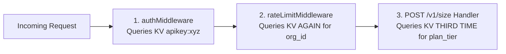
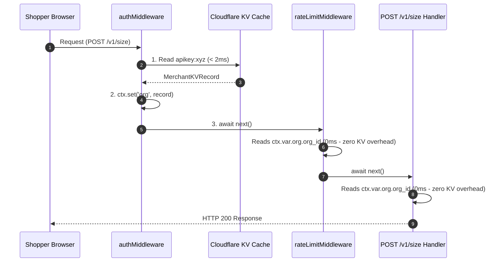

# Module 02: Edge Authentication, Threat Modeling & Request Context Storage

---

## 1. Threat Modeling Storefront API Keys

### The Inherent Vulnerability of Storefront API Keys
In traditional backend architecture, API keys are secret credentials stored in environment variables. However, a storefront widget runs **inside the shopper's browser**.

When the Snug widget issues an HTTP POST to `https://api.snug.app/v1/size`, the `X-Snug-Key` header is completely visible to anyone opening Chrome DevTools Network tab.

### Security Threats & Defenses

| Threat | Attack Vector | Security Defense | Response Code |
|---|---|---|---|
| **Key Theft & Hotlinking** | Attacker copies `X-Snug-Key` from merchant A's site and embeds it on `evil-site.com` or runs a bot script. | **Dual-Layer Origin Validation**: Browser stamps untamperable `Origin` header. Worker rejects non-matching origins. | `401 Unauthorized` (`"Origin domain mismatch"`) |
| **Uninstalled / Paused App Abuse** | Merchant uninstalls Snug or disables widget, but cached JS bundles continue sending requests. | **KV `widget_active` Flag Check**: Fast KV lookup checks live merchant status at the edge. | `403 Forbidden` (`"Widget is inactive"`) |
| **Quota Exhaustion** | Merchant reaches trial limit (1,000 requests). | **`trial_requests_remaining` Quota Check**: Immediate edge rejection. | `403 Forbidden` (`"No requests remaining"`) |

---

## 2. HTTP Header Conventions & Notation Style (`X-Snug-Key`)

### The `X-` Header Prefix Convention
In HTTP networking standards, custom application-specific headers (which are not part of the standard IETF HTTP specification like `Content-Type` or `Authorization`) historically carry an **`X-`** prefix (short for **Extension** or **eXperimental**).

Industry examples of custom API keys and tracing headers:
- `X-Shopify-Access-Token` (Shopify API Authentication)
- `X-Request-ID` (Microservice Distributed Tracing)
- `X-Forwarded-For` (Proxy IP Tracking)
- `X-Snug-Key` (Snug Storefront API Key)

### Casing Style: HTTP Train-Case (Pascal-Kebab-Case)
Header names use **Train-Case** formatting, where words are hyphenated (`-`) and each word begins with a capital letter (`X`, `Snug`, `Key`).

| Casing Style | Example Syntax | Standard Domain Usage |
|---|---|---|
| **Train-Case** | `X-Snug-Key` | **HTTP Header Names** |
| **camelCase** | `xSnugKey` | JavaScript variables / JSON payload keys |
| **kebab-case** | `x-snug-key` | URL paths / CSS class selectors |
| **snake_case** | `x_snug_key` | Database column names / Python variables |
| **PASCAL_CASE** | `X_SNUG_KEY` | Environment variables / Global constants |

### Case Insensitivity in HTTP Headers
Per Section 3.2 of RFC 7230, **HTTP header names are strictly case-insensitive**. Whether a client sends `X-Snug-Key`, `x-snug-key`, or `X-SNUG-KEY`, Hono's `ctx.req.header("X-Snug-Key")` lookup normalizes header keys internally, ensuring seamless matching across all clients.

---

## 3. Browser `Origin` Header Immutability

### Why the `Origin` Header Cannot Be Spoofed in Browsers
The W3C Fetch Standard classifies the `Origin` header as a **Forbidden Header Name**. 
Browsers explicitly forbid JavaScript running in a web page (via `fetch()`, `XMLHttpRequest`, or `axios`) from overriding or modifying the `Origin` header.

When a shopper visits `https://my-store.myshopify.com`:
- The browser automatically stamps `Origin: https://my-store.myshopify.com` on cross-origin requests.
- If an attacker on `https://evil-site.com` tries to set `fetch(url, { headers: { Origin: 'https://my-store.myshopify.com' } })`, the browser silently ignores the header parameter and stamps `Origin: https://evil-site.com`.

### Regex Origin Sanitization Logic
Incoming `Origin` headers may contain scheme prefixes (`https://`, `http://`) and trailing slashes (`/`). Our middleware cleans the origin before comparing it against the merchant's `shop` domain (e.g. `my-store.myshopify.com`):

```typescript
const rawOrigin = ctx.req.header("Origin") || ctx.req.header("origin");

// Strip scheme (https:// or http://) and trailing slashes (/)
const cleanOrigin = rawOrigin
  ? rawOrigin.replace(/^https?:\/\//, "").replace(/\/$/, "")
  : "";

if (!rawOrigin || cleanOrigin !== record.shop) {
  return ctx.json({ error: "Unauthorized", message: "Origin domain mismatch" }, 401);
}
```

---

## 4. Deep Dive: Why We Use `ctx.set("org", record)` (Request-Local Storage)

### What `ctx.set(key, value)` Does
`ctx.set("org", record)` is Hono's API for attaching request-scoped variables to the current execution context (`ctx.var`).

### The Performance Problem It Solves

Without `ctx.set("org", record)`, look at what would happen during a single request pipeline:



By calling `ctx.set("org", record)` inside `authMiddleware`:
1. `authMiddleware` performs the KV lookup **once**.
2. It attaches the fetched `MerchantKVRecord` object to `ctx.var.org`.
3. All downstream middlewares and route handlers read `ctx.var.org` in **0ms** without repeating KV reads or incurring unnecessary cache lookups.



---

## 5. Final Annotated Implementation of `worker/src/middleware/auth.ts`

```typescript
import { createMiddleware } from "hono/factory";

// Data contract matching KV apikey:{api_key} records and @snug/db schema
export interface MerchantKVRecord {
  org_id: string;
  shop: string;
  plan_tier: "trial" | "paid";
  trial_requests_remaining: number;
  widget_active: boolean;
}

export const authMiddleware = createMiddleware(async (ctx, next) => {
  // 1. Extract API Key from X-Snug-Key header
  const apiKey = ctx.req.header("X-Snug-Key");
  if (!apiKey) {
    return ctx.json({ error: "Unauthorized", message: "Missing API Key" }, 401);
  }

  // 2. Fetch merchant record from Cloudflare KV (sub-2ms edge read)
  const record = (await ctx.env.KV.get(
    `apikey:${apiKey}`,
    "json"
  )) as MerchantKVRecord | null;

  if (!record) {
    return ctx.json({ error: "Unauthorized", message: "Invalid API Key" }, 401);
  }

  // 3. Verify widget active status
  if (!record.widget_active) {
    return ctx.json({ error: "Forbidden", message: "Widget is inactive" }, 403);
  }

  // 4. Dual-Layer Defense: Sanitize & validate untamperable browser Origin header
  const rawOrigin = ctx.req.header("Origin") || ctx.req.header("origin");
  const cleanOrigin = rawOrigin
    ? rawOrigin.replace(/^https?:\/\//, "").replace(/\/$/, "")
    : "";

  if (!rawOrigin || cleanOrigin !== record.shop) {
    return ctx.json({ error: "Unauthorized", message: "Origin domain mismatch" }, 401);
  }

  // 5. Check remaining trial quota
  if (record.trial_requests_remaining === 0) {
    return ctx.json({ error: "Forbidden", message: "No requests remaining" }, 403);
  }

  // 6. Inject MerchantKVRecord into Hono context for 0ms downstream access
  ctx.set("org", record);

  // 7. Pass control to downstream rate-limiting middleware or route handler
  await next();
});
```
