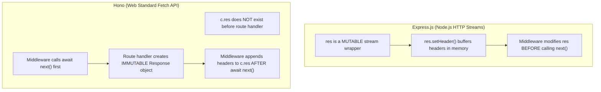
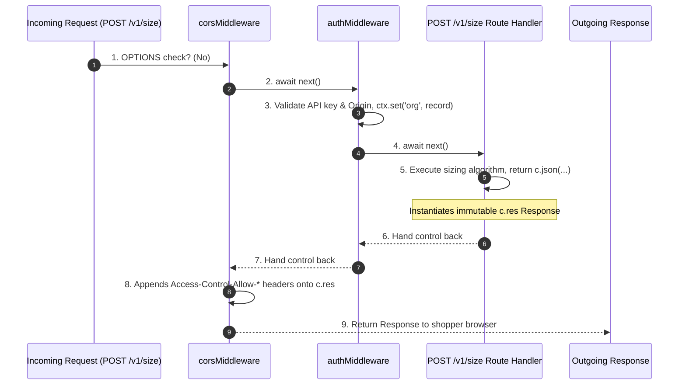

# Module 03: Hono Middleware Lifecycle, Routing & Type-Safe Context Wiring

---

## 1. Hono vs. Express Architectural Comparison

### Web Standard Fetch API vs. Node.js Streams

Understanding why Hono behaves differently from legacy Node.js frameworks like Express requires examining the underlying runtime primitives:



---

## 2. The Hono Async Onion Model Lifecycle

Hono uses an **async onion middleware execution flow**. Execution flows down through pre-processing steps, executes the core route handler, and then flows back up through post-processing steps:



---

## 3. Global vs. Path-Scoped Middleware Mounting

In `worker/src/index.ts`, we mount middlewares with explicit path scoping:

```typescript
// Global Middleware: Applies CORS to ALL routes (including /health)
app.use("*", corsMiddleware);

// Scoped Middleware: Applies auth ONLY to API endpoints under /v1/*
app.use("/v1/*", authMiddleware);
```

### Why `/health` Must Bypass `authMiddleware`

- **Uptime Monitoring**: Services like Cloudflare Health Checks, UptimeRobot, or Railway health probes call `GET /health` periodically to verify system operational status.
- If `authMiddleware` were mounted on `*`, `GET /health` would fail with `401 Unauthorized ("Missing API Key")` because external monitors do not possess a merchant API key.
- Scoping `authMiddleware` strictly to `/v1/*` keeps `/health` publicly accessible while securing all production API routes.

---

## 4. Type-Safe Hono Environment & Context Wiring

To give downstream route handlers TypeScript autocomplete for context variables (`c.var.org`), we define Hono's `AppEnv` generic interface:

```typescript
import type {
  KVNamespace,
  DurableObjectNamespace,
} from "@cloudflare/workers-types";
import type { MerchantKVRecord } from "./middleware/auth";

// Cloudflare Workers Environment Bindings
export interface Env {
  DATABASE_URL: string;
  ENVIRONMENT: string;
  KV: KVNamespace;
  USAGE_COUNTER: DurableObjectNamespace;
}

// Hono Application Environment Schema
export type AppEnv = {
  Bindings: Env;
  Variables: {
    org: MerchantKVRecord;
  };
};

const app = new Hono<AppEnv>();
```

---

## 5. Final Annotated Implementation of `worker/src/index.ts`

```typescript
import { Hono } from "hono";
import type {
  KVNamespace,
  DurableObjectNamespace,
} from "@cloudflare/workers-types";

import { corsMiddleware } from "./middleware/cors";
import { authMiddleware, type MerchantKVRecord } from "./middleware/auth";

// 1. Define Environment Bindings matching wrangler.toml
export interface Env {
  DATABASE_URL: string;
  ENVIRONMENT: string;
  KV: KVNamespace;
  USAGE_COUNTER: DurableObjectNamespace;
}

// 2. Define Type-Safe Context Schema
export type AppEnv = {
  Bindings: Env;
  Variables: {
    org: MerchantKVRecord;
  };
};

// 3. Initialize Hono App with AppEnv generic
const app = new Hono<AppEnv>();

// 4. Mount Global CORS Middleware (Applies to all routes including /health)
app.use("*", corsMiddleware);

// 5. Mount Auth Middleware (Scoped strictly to /v1/* endpoints)
app.use("/v1/*", authMiddleware);

// 6. Public Health Check Endpoint
app.get("/health", (c) => {
  return c.json({
    status: "ok",
    environment: c.env.ENVIRONMENT,
  });
});

// 7. Export Durable Object class binding for Workers runtime
export { UsageCounter } from "./durable-objects/UsageCounter";

// 8. Default export Hono application fetch handler
export default app;
```
