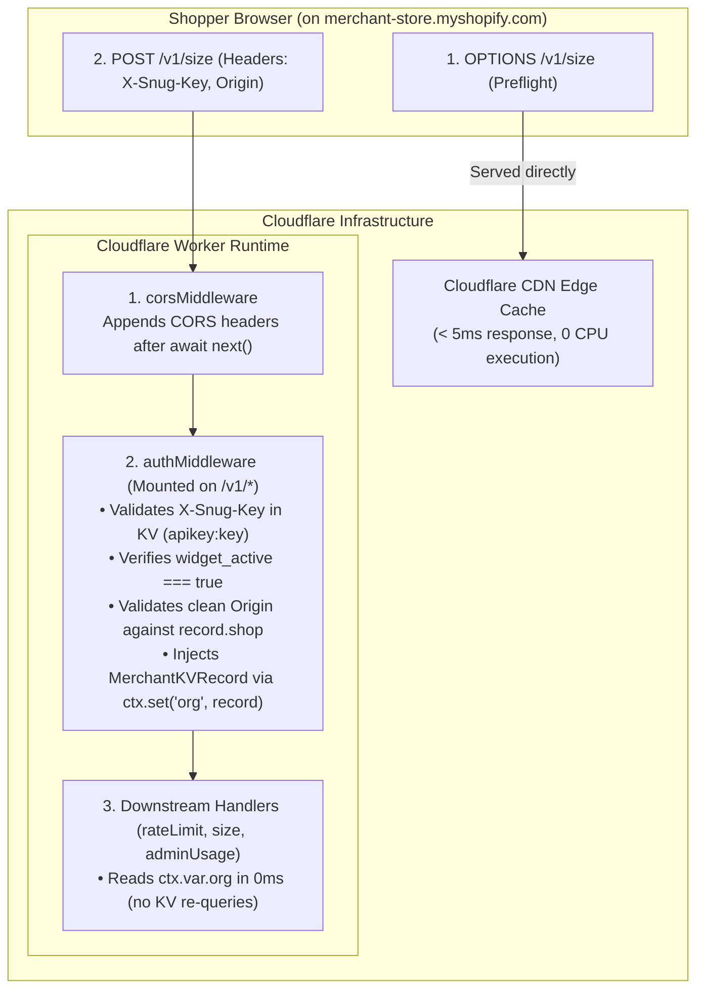

# Lesson 04: Edge Middleware Architecture — CORS, Authentication & Context in Hono

> **Workstream**: Priyanshu (Platform API & Infrastructure)  
> **Task Ref**: TASK-P04 — Hono Middleware Setup  
> **Format**: Mentor-Apprentice First-Principles Deep Dive  

---

## 1. Executive Summary & Learning Objectives

This module documents the first-principles architecture, threat modeling, protocol mechanics, and code implementation of the edge middleware layer for the Snug Cloudflare Worker sizing API.

### Core Takeaways & Competencies Covered:
1. **HTTP CORS Protocol Mechanics**: Understanding preflight `OPTIONS` requests, HTTP 204 No Content semantics, and why CORS headers must exist on both preflight and actual `POST`/`GET` payloads.
2. **CDN Edge Caching vs. Dynamic Origin Reflection**: Why returning static `Access-Control-Allow-Origin: *` on preflight requests enables 100% CDN edge caching (< 5ms response, 0 CPU worker execution), and how application-level `Origin` validation maintains security.
3. **Browser Security & Forbidden Headers**: Leveraging the immutability of the browser-stamped `Origin` header as a dual-layer defense against key theft and hotlinking.
4. **Hono Onion Model vs. Express Node.js Streams**: Contrasting Node.js's mutable `http.ServerResponse` header buffering with Web Standard Fetch API (`Request`/`Response`) immutable objects in Hono.
5. **Request Context Data Passing (`c.set()` / `c.get()`)**: Utilizing Hono context variables to share KV lookups (`MerchantKVRecord`) downstream in **0ms** without repeating database or cache reads.

---

## 2. Lesson Structure & Sitemap

- **[01-cors-deep-dive.md](file:///home/bhondu/coding/projects/planicle/Snug/docs/priyanshu/learn/task-04-hono-middleware-and-auth/01-cors-deep-dive.md)**  
  Detailed analysis of Cross-Origin Resource Sharing, 2-phase browser handshakes, HTTP 204 semantics, CDN edge preflight caching, data structure choices, and `cors.ts` implementation.

- **[02-edge-authentication-and-context.md](file:///home/bhondu/coding/projects/planicle/Snug/docs/priyanshu/learn/task-04-hono-middleware-and-auth/02-edge-authentication-and-context.md)**  
  Threat modeling storefront API key exposure, sub-2ms Cloudflare KV reads, untamperable `Origin` sanitization/matching, request-local storage (`c.set()`), and `auth.ts` implementation.

- **[03-hono-middleware-lifecycle-and-routing.md](file:///home/bhondu/coding/projects/planicle/Snug/docs/priyanshu/learn/task-04-hono-middleware-and-auth/03-hono-middleware-lifecycle-and-routing.md)**  
  Architectural comparison of Hono (Fetch API) vs Express (Node.js HTTP), async onion model execution, path-scoped middleware mounting (`/v1/*`), and type-safe `AppEnv` context wiring in `index.ts`.

---

## 3. System Architecture Diagram

