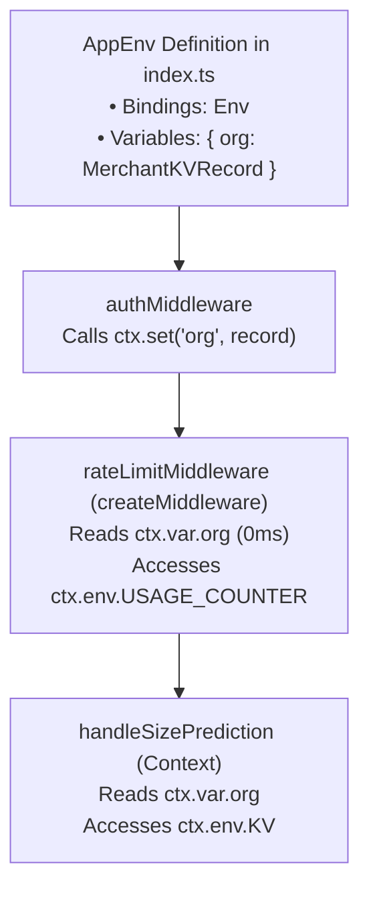

# Module 02: Hono AppEnv & Type-Safe Context Schemas

---

## 1. First-Principles Concept: Framework Context Typing

### The Problem with Untyped Contexts
In Hono, the `Context` object (`c` or `ctx`) represents an HTTP request/response cycle. By default, Hono has no knowledge of what environment bindings exist in your `wrangler.toml` or what custom data your middlewares attach to the request.

Without explicit generic typing:
- Accessing `c.env.KV` or `c.env.USAGE_COUNTER` results in TypeScript treating `c.env` as generic `any` or `{}`.
- Accessing custom variables set by upstream middlewares (`c.var.org`) throws `TS2339: Property 'org' does not exist on type 'Variables'`.

---

## 2. The `AppEnv` Type Schema

`AppEnv` is defined in `worker/src/index.ts` as the central authoritative type contract:

```typescript
import type { KVNamespace, DurableObjectNamespace } from '@cloudflare/workers-types';
import type { MerchantKVRecord } from './middleware/auth';

// 1. Bindings: What Wrangler & Cloudflare Worker runtime inject into c.env
export interface Env {
  DATABASE_URL: string;
  ENVIRONMENT: string;
  KV: KVNamespace;
  USAGE_COUNTER: DurableObjectNamespace;
}

// 2. AppEnv Schema: Combines Bindings (c.env) and Variables (c.var)
export type AppEnv = {
  Bindings: Env;
  Variables: {
    org: MerchantKVRecord;
  };
};
```

---

## 3. How `AppEnv` Flows Through Middlewares & Handlers

By passing `AppEnv` to `createMiddleware<AppEnv>` or `Context<AppEnv>`, TypeScript gains complete autocomplete and strict type checking:



---

## 4. Summary Table

| Concept | Accessor Syntax | Source of Truth | Purpose |
|---|---|---|---|
| **Bindings** | `ctx.env` | `wrangler.toml` & Cloudflare Runtime | Access KV namespaces, Durable Objects, environment variables. |
| **Variables** | `ctx.var` | `ctx.set(key, value)` in middlewares | Access request-local data (like authenticated `MerchantKVRecord`). |
| **Execution Context** | `ctx.executionCtx` | Cloudflare Worker Host Runtime | Access `waitUntil(promise)` for non-blocking background tasks. |
