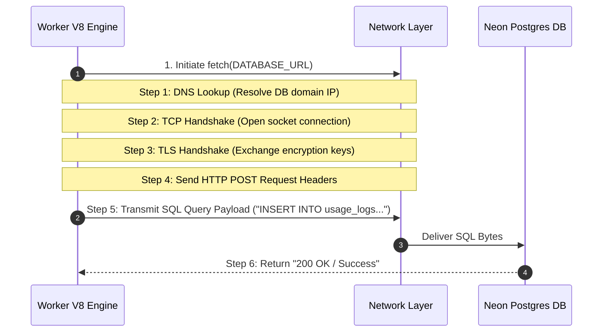
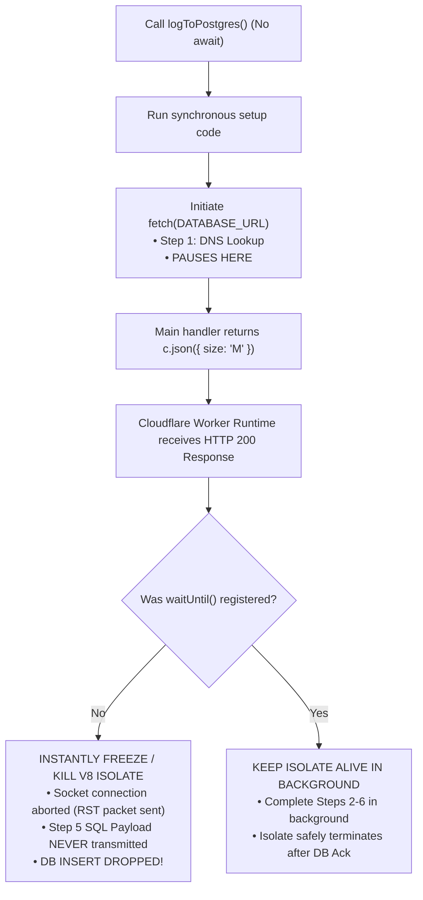

# Module 03: Async JavaScript Event Loop, Network Physics & `waitUntil`

---

## 1. The Physics of Asynchronous Network Requests

Connecting to a database or external API over TCP/HTTP is not a single instantaneous action. It is a multi-step asynchronous handshake:



---

## 2. Why Un-Awaited Promises Drop Packets in Serverless Isolates

### The DNS Lookup Yield Point
When an `async` function invokes `fetch(...)` or a database query without `await`:

1. JavaScript starts executing `logToPostgres()`. It runs synchronously up to the first `await` (Step 1: DNS Lookup / Socket Creation).
2. At that first `await`, `logToPostgres()` **yields control back to the event loop** and returns a pending `Promise`.
3. **Crucial Reality**: At this exact millisecond, **the actual SQL query payload bytes (Step 5) have NOT left the server yet!**



---

## 3. Comparison Matrix: Execution Strategies

| Execution Pattern | Shopper Response Latency | Database Persistence | Isolate State |
|---|---|---|---|
| `await logToPostgres()` | **Slow (150ms)** (Blocked waiting for DB roundtrip) | Guaranteed | Active until DB responds |
| `logToPostgres()` (No `await`, No `waitUntil`) | **Fast (< 5ms)** | **DROPPED** (Isolate freezes mid-DNS lookup) | Instantly frozen/terminated |
| `ctx.executionCtx.waitUntil(logToPostgres())` | **Fast (< 5ms)** (Response sent instantly) | Guaranteed | Kept alive in background until Promise resolves |

---

## 4. The W3C Service Worker Standard (`waitUntil`)

### What is the W3C Service Worker Standard?
The **W3C (World Wide Web Consortium)** is the international standards body for the Web. In browser Service Workers, background scripts handle offline caching and push notifications using the standard method:

```javascript
event.waitUntil(promise)
```

This method tells the host runtime environment:
> *"I am performing background work. Do NOT terminate or freeze this execution isolate until this promise settles!"*

Cloudflare Workers were built on Google Chrome's V8 engine using standard W3C Web Platform APIs. In Hono on Cloudflare Workers, **`ctx.executionCtx.waitUntil(promise)`** is the exact type-safe wrapper around this W3C standard.
