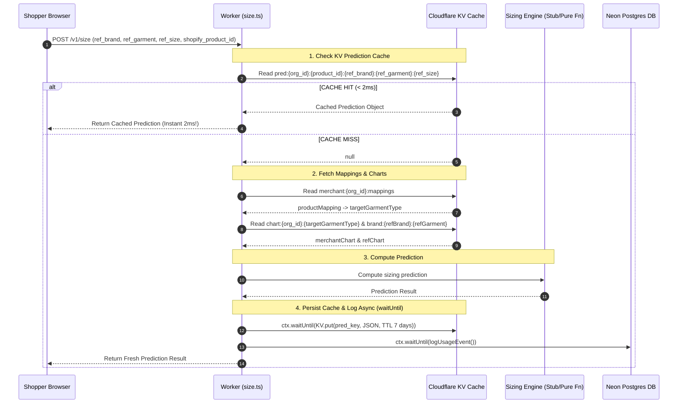
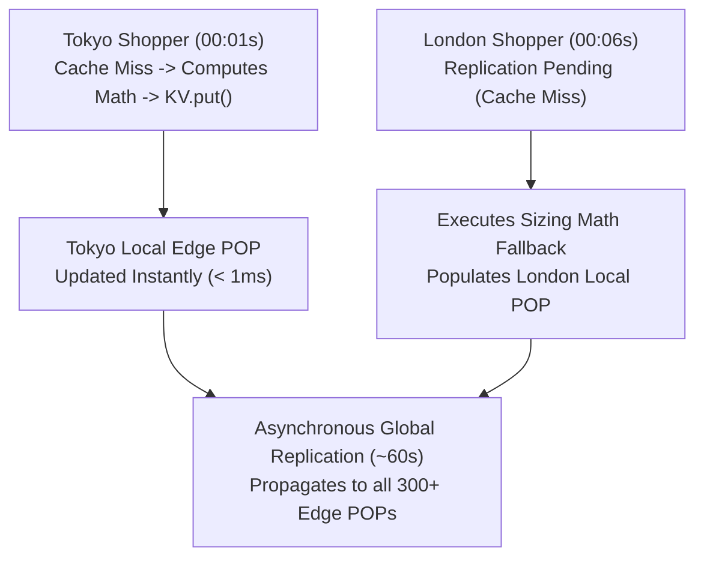

# Module 05: KV Prediction Caching Architecture & Distributed Systems Trade-offs

---

## 1. First-Principles Concept: Edge Prediction Caching

### The Problem: Redundant Mathematical Computations
On a high-traffic Shopify storefront product page (e.g. `my-store.myshopify.com/products/oversized-tshirt`), thousands of shoppers select identical input parameters (e.g. *"I wear Size L in Uniqlo T-Shirts"*).

Executing the 9-step sizing translation algorithm repeatedly for identical inputs:
- Wastes worker CPU execution time and isolate memory.
- Triggers redundant KV fetches for merchant size charts and reference brand charts.
- Increases API latency unnecessarily for repeat shopper input patterns.

---

## 2. The KV Prediction Cache Pattern

We construct a unique, deterministic KV cache key for every distinct combination of merchant organization, product ID, reference brand, reference garment, and reference size:

```
pred:{org_id}:{shopify_product_id}:{ref_brand}:{ref_garment}:{ref_size}
```



---

## 3. Distributed Systems Mechanics: Eventual Consistency & Concurrency

### What Happens During the 60-Second KV Replication Window?
Cloudflare KV replicates keys globally across 300+ edge Points of Presence (POPs) within ~60 seconds.

If a shopper in Tokyo issues a prediction request at 00:01s and a shopper in London issues the exact same request at 00:06s:
- **Tokyo POP**: Immediate cache write (`< 1ms`). Subsequent shoppers in Tokyo get instant KV cache hits.
- **London POP**: If global KV replication is still in progress, London receives a **Cache Miss** (`null`).
- **Self-Healing Fallback**: London POP simply falls back to computing the sizing math, returning the correct response, and populating London's local POP cache.
- **Result**: The API never fails or returns stale errors. Global edge caching is completely self-healing.



### Last-Write-Wins (LWW) Concurrency Safety
In prediction caching, cache keys represent **idempotent snapshots** of pure function results:
- For deterministic calculation inputs, concurrent writes write the exact same JSON bytes.
- For probabilistic models, KV's Last-Write-Wins (LWW) resolution overwrites the key safely without data corruption or partial reads.

---

## 4. Architectural Trade-Off: Cloudflare KV vs. Durable Objects for Caching

| Architectural Dimension | Cloudflare KV | Cloudflare Durable Objects (DO) |
|---|---|---|
| **Primary Design Purpose** | **Global Read-Heavy Edge Storage** | **Single-Location Atomic Coordination** |
| **Global Read Latency** | **< 2ms** (Served from local POP RAM anywhere on Earth) | **50ms – 250ms** (Network roundtrip across oceans to single DO location) |
| **Consistency Model** | Eventual Consistency (Global LWW) | Immediate Strong Consistency (Single-Isolate Memory) |
| **Capacity & Scalability** | **Unlimited** (Millions of cache entries with TTL) | Limited per DO instance (~10GB SQLite limit) |
| **Optimal Use Case in Snug** | **Prediction Caching, Charts, Auth Keys** | **Atomic Trial Counter Decrements (`UsageCounter`)** |

### Why Durable Objects are Wrong for Caching (The Ocean Latency Trap)
A Durable Object instance resides in **a single specific geographical data center** (e.g. US-East Virginia). If a shopper in Tokyo or London requests a cached prediction from a DO, the Worker must send a network packet across the Pacific/Atlantic Ocean:

```
Shopper in Tokyo ──► Tokyo Edge POP (KV Read) ─────────────► < 2ms Response!

                                VS

Shopper in Tokyo ──► Tokyo POP ──► [Pacific Ocean] ──► US-East DO Isolate ──► 200ms Latency!
```

By keeping prediction caching in **Cloudflare KV**, shoppers worldwide enjoy **< 2ms local edge reads**, while Durable Objects handle single-threaded atomic counter decrements (`UsageCounter`) where race conditions cannot be tolerated.
