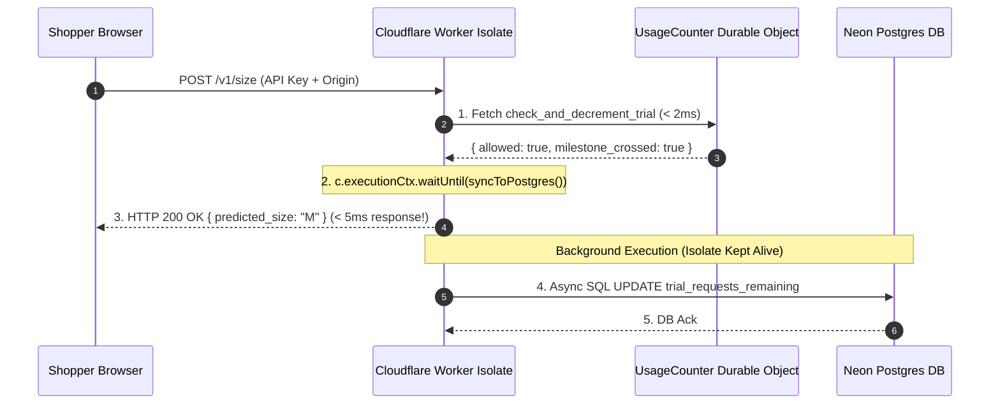

# Lesson 05: Edge Rate-Limiting, Hono AppEnv & Serverless Event Loop Execution

> **Workstream**: Priyanshu (Platform API & Infrastructure)  
> **Task Ref**: TASK-P05 — Edge Rate-Limiting & Quota Middleware  
> **Format**: Mentor-Apprentice First-Principles Deep Dive  

---

## 1. Executive Summary & Learning Objectives

This module documents the first-principles mechanics of edge rate-limiting using Cloudflare Durable Objects, type-safe application environment schemas (`AppEnv`), and the V8 serverless event loop lifecycle (`ctx.executionCtx.waitUntil`).

### Core Takeaways & Competencies Covered:
1. **Edge Rate-Limiting via Durable Objects**: Why single-threaded Durable Objects deliver sub-millisecond atomic quota checks (< 2ms) without race conditions or database roundtrips.
2. **Type-Safe Hono Environment Schemas (`AppEnv`)**: How combining `Bindings` (Wrangler environment bindings) and `Variables` (custom request-local `ctx.set` data) eliminates TypeScript errors across all middlewares and endpoint handlers.
3. **Async Network Handshake Physics**: Understanding the 5-step TCP/TLS/HTTP network lifecycle (DNS lookup, TCP connect, TLS handshake, header transfer, SQL payload transfer).
4. **V8 Isolate Lifetime & Serverless Freezing**: Why un-awaited promises drop network packets in serverless environments when the main HTTP response returns.
5. **Non-Blocking Background Tasks (`ctx.executionCtx.waitUntil`)**: Utilizing the W3C Service Worker `waitUntil` standard to return sub-5ms HTTP responses while safely completing background analytics logging and database syncs.

---

## 2. Lesson Structure & Sitemap

- **[01-edge-rate-limiting-and-durable-objects.md](file:///home/bhondu/coding/projects/planicle/Snug/docs/priyanshu/learn/task-05-rate-limiting-and-handlers/01-edge-rate-limiting-and-durable-objects.md)**  
  Threat modeling trial quotas, why DOs beat KV and Postgres for atomic decrements, and `rateLimit.ts` implementation.

- **[02-hono-appenv-and-type-safety.md](file:///home/bhondu/coding/projects/planicle/Snug/docs/priyanshu/learn/task-05-rate-limiting-and-handlers/02-hono-appenv-and-type-safety.md)**  
  Detailed breakdown of `AppEnv`, `Bindings` (`c.env`), `Variables` (`c.var`), and Hono middleware context generic typing.

- **[03-async-javascript-event-loop-and-waituntil.md](file:///home/bhondu/coding/projects/planicle/Snug/docs/priyanshu/learn/task-05-rate-limiting-and-handlers/03-async-javascript-event-loop-and-waituntil.md)**  
  Deep dive into the 5-step network packet physics, DNS lookup yield points, V8 isolate freezing, and the W3C Service Worker `waitUntil` standard.

- **[04-defensive-edge-engineering-patterns.md](file:///home/bhondu/coding/projects/planicle/Snug/docs/priyanshu/learn/task-05-rate-limiting-and-handlers/04-defensive-edge-engineering-patterns.md)**  
  Safe `.catch(() => null)` JSON parsing, KV key `.trim().toLowerCase()` sanitization, and defensive `waitUntil` error isolation.

- **[05-edge-prediction-caching.md](file:///home/bhondu/coding/projects/planicle/Snug/docs/priyanshu/learn/task-05-rate-limiting-and-handlers/05-edge-prediction-caching.md)**  
  Sub-2ms KV prediction cache architecture (`pred:{org_id}:{product_id}:{ref_brand}:{ref_garment}:{ref_size}`), cache hit/miss flow, and async background TTL caching.

---

## 3. System Architecture Diagram

