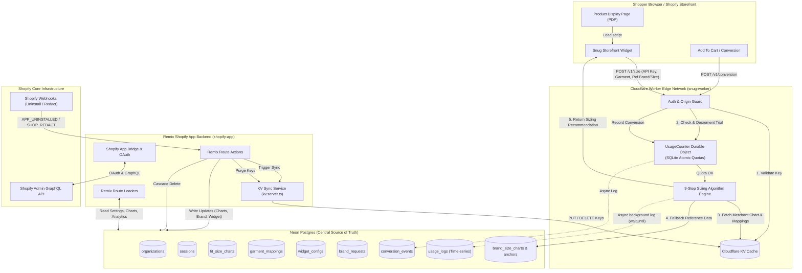
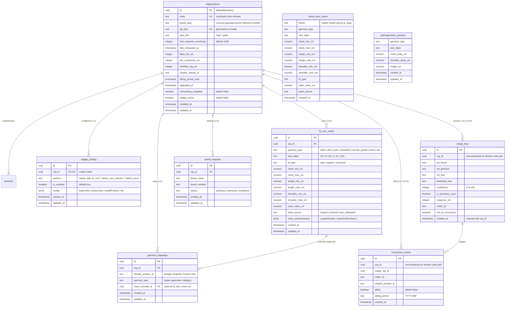

# Snug — Schema Design, Data Flow & Storage Architecture

> **Author**: Priyanshu & Rudra Architecture Alignment  
> **Target Path**: `docs/priyanshu/schema_analysis.md`  
> **Last Updated**: August 2026  
> **Scope**: Exhaustive inventory of all data models, retrieval/mutation patterns across `shopify-app/app/routes/`, Neon Postgres Drizzle schema, Cloudflare KV edge cache, and Cloudflare Durable Objects (`UsageCounter`).

---

## 1. Executive Summary & Storage Topology

Snug uses a **hybrid multi-tier data architecture** designed for sub-50ms global sizing inference at the edge while preserving transactional ACID integrity and relational reporting in a centralized database:

```
┌───────────────────────────────────────────────────────────────────────────────────────────────────┐
│                                       STORAGE TOPOLOGY                                            │
├────────────────────────┬─────────────────────────┬───────────────────────┬────────────────────────┤
│ 1. Neon Postgres       │ 2. Cloudflare KV        │ 3. Cloudflare DOs     │ 4. Shopify GraphQL API │
│ (Source of Truth)      │ (Edge Read-Cache)       │ (Edge Quota / State)  │ (External Authority)   │
├────────────────────────┼─────────────────────────┼───────────────────────┼────────────────────────┤
│ • Tenancy & Billing    │ • `apikey:{key}`        │ • `UsageCounter`      │ • Storefront Catalog   │
│ • Sizing Charts (CRUD) │ • `shop:{domain}`       │ • Atomic trial decrement│ Products & Variants │
│ • Garment Mappings     │ • `chart:{org}:{garment}`│ • Live monthly billing│ • Shop Domain & Info   │
│ • Historical Logs      │ • `merchant:{org}:map`  │   conversions counter │ • App Bridge Auth      │
│ • Conversion Events    │ • Sub-10ms global edge  │ • Serialized SQLite   │ • Webhook Ingestion    │
│ • Reference Catalogs   │   lookups for Worker    │   storage per org     │   (Uninstall / Redact) │
└────────────────────────┴─────────────────────────┴───────────────────────┴────────────────────────┘
```

### 1.1 Live Neon Database Audit (Verified via Direct Introspection)

Direct SQL introspection of the active Neon PostgreSQL cluster (`ep-small-band-aza4myse-pooler.c-3.ap-southeast-1.aws.neon.tech`) confirms that **all 10 tables are physically created and live in the `public` schema**:

| Table Name | Live Status | Row Count | Primary Key / Unique Keys | Foreign Keys |
|---|---|---|---|---|
| [`organizations`](file:///home/bhondu/coding/projects/planicle/Snug/packages/db/src/schema.ts#L24-L49) | **LIVE** | 1 row (`try-on-9231.myshopify.com`) | PK: `id`, UK: `shop`, UK: `api_key` | None |
| [`session`](file:///home/bhondu/coding/projects/planicle/Snug/packages/db/src/schema.ts#L4-L22) | **LIVE** | 1 row | PK: `id` | None |
| [`widget_configs`](file:///home/bhondu/coding/projects/planicle/Snug/packages/db/src/schema.ts#L51-L61) | **LIVE** | 1 row | PK: `id`, UK: `org_id` | `org_id` → `organizations.id` |
| [`fit_size_charts`](file:///home/bhondu/coding/projects/planicle/Snug/packages/db/src/schema.ts#L63-L95) | **LIVE** | 3 rows (`tshirt` S, M, L) | PK: `id`, UK: `(org_id, garment_type, size_label)` | `org_id` → `organizations.id` |
| [`garment_mappings`](file:///home/bhondu/coding/projects/planicle/Snug/packages/db/src/schema.ts#L97-L108) | **LIVE** | 0 rows | PK: `id`, UK: `(org_id, shopify_product_id)` | `org_id` → `organizations.id`, `chart_override_id` → `fit_size_charts.id` |
| [`brand_requests`](file:///home/bhondu/coding/projects/planicle/Snug/packages/db/src/schema.ts#L110-L118) | **LIVE** | 0 rows | PK: `id` | `org_id` → `organizations.id` |
| [`usage_logs`](file:///home/bhondu/coding/projects/planicle/Snug/packages/db/src/schema.ts#L120-L147) | **LIVE** | 0 rows | PK: `id` | None (Worker direct write) |
| [`conversion_events`](file:///home/bhondu/coding/projects/planicle/Snug/packages/db/src/schema.ts#L149-L173) | **LIVE** | 0 rows | PK: `id` | None (Worker direct write) |
| [`brand_size_charts`](file:///home/bhondu/coding/projects/planicle/Snug/packages/db/src/schema.ts#L175-L211) | **LIVE** | 0 rows *(Needs seeding)* | PK: `(brand, garment_type, size_label)` | None |
| [`anthropometric_anchors`](file:///home/bhondu/coding/projects/planicle/Snug/packages/db/src/schema.ts#L213-L234) | **LIVE** | 0 rows *(Needs seeding)* | PK: `(garment_type, size_label)` | None |


---

## 2. System Architecture & Data Flow (Mermaid Diagrams)

### 2.1 Full End-to-End System & Ingestion Pipeline



---

### 2.2 Entity Relationship Diagram (Neon Postgres & Durable Objects)



---

## 3. Storage Layer Breakdown & Data Boundaries

### 3.1 Tier 1: Neon Postgres (Central Relational Database)
* **Technology**: Postgres 16 on Neon, managed with **Drizzle ORM** (`packages/db/src/schema.ts`).
* **Role**: Single source of truth for merchant configurations, size charts, product catalog mappings, billing metrics, aggregated analytics, and GDPR compliance.
* **Connection Modes**:
  - `shopify-app`: Standard pooling connection via `@neondatabase/serverless` / node Postgres client for transactional CRUD.
  - `snug-worker`: Direct HTTP-based connection (`neon(env.DATABASE_URL)`) used exclusively in `waitUntil()` background logs or on-demand cron reconciliation.

### 3.2 Tier 2: Cloudflare KV (Edge Read-Through Cache)
* **Namespace ID**: `9adf9e3534794fc58cd25ce4f225c465` (Preview: `76761b47b9b54f689f6e32e22f5ad6db`).
* **Role**: Sub-10ms globally replicated key-value storage for storefront Worker inference.
* **Active Keys & Data Shapes**:

| Key Template | Example Key | Payload Structure | Synced By | Read By |
|---|---|---|---|---|
| `apikey:{apiKey}` | `apikey:4f8a...` | `MerchantKVPayload`: `{ org_id, shop, plan_tier, trial_requests_remaining, widget_active, api_key }` | `pushApiKeyToKV` (Auth / Widget toggle) | Worker Auth Guard |
| `shop:{shop}` | `shop:snitch.myshopify.com` | `{ org_id, api_key }` | `pushApiKeyToKV` (Install) | Worker Admin Lookup |
| `chart:{orgId}:{garmentType}` | `chart:18b9...:tshirt` | Array of sorted size objects with min/max cm, ease allowances, and guide gender | `pushChartToKV` (Size Charts CRUD) | Worker Sizing Engine |
| `merchant:{orgId}:mappings` | `merchant:18b9...:mappings` | `Record<shopifyProductId, { garment_type: string, is_active: boolean }>` | `pushMappingsToKV` (Products Map) | Worker Sizing Engine |

### 3.3 Tier 3: Cloudflare Durable Objects (`UsageCounter`)
* **Class**: `UsageCounter` (`worker/src/durable-objects/UsageCounter.ts`) with native SQLite storage.
* **Role**: High-concurrency serialized quota authority to prevent race conditions during trial request exhaustion and to track real-time monthly billing conversions.
* **Internal SQLite Schema**:
  ```sql
  CREATE TABLE IF NOT EXISTS usage (
    org_id TEXT PRIMARY KEY,
    plan_tier TEXT NOT NULL DEFAULT 'trial',
    usage_remaining INTEGER NOT NULL DEFAULT 1000,
    monthly_conversions INTEGER NOT NULL DEFAULT 0,
    billing_start TEXT NOT NULL DEFAULT (datetime('now')),
    updated_at TEXT NOT NULL DEFAULT (datetime('now'))
  );
  ```

### 3.4 Tier 4: Shopify Admin GraphQL API
* **Role**: Authoritative provider for catalog products, variant pricing, featured image CDN URLs, live merchant shop metadata, and OAuth access tokens.

---

## 4. Route-by-Route Data Inventory & Retrieval Tasks

Every route in `shopify-app/app/routes/` has been analyzed down to each database operation, GraphQL call, and state transition:

### 4.1 Root & Authentication
* [`app/routes/auth.$.tsx`](file:///home/bhondu/coding/projects/planicle/Snug/shopify-app/app/routes/auth.$.tsx):
  - **Retrieval**: `authenticate.admin(request)` validates OAuth session against `sessions` table.
  - **Mutation (`afterAuth` hook)**:
    1. Registers mandatory Shopify webhooks (`APP_UNINSTALLED`, `SHOP_REDACT`).
    2. Upserts `organizations` record with initial `apiKey = randomUUID()`, `planTier = 'trial'`, `trialRequestsRemaining = 1000`.
    3. Triggers `pushApiKeyToKV` to seed `apikey:*` and `shop:*` in Cloudflare KV.
* [`app/routes/auth.login/route.tsx`](file:///home/bhondu/coding/projects/planicle/Snug/shopify-app/app/routes/auth.login/route.tsx):
  - Handles manual domain login redirection to Shopify OAuth.
* [`app/routes/_index/route.tsx`](file:///home/bhondu/coding/projects/planicle/Snug/shopify-app/app/routes/_index/route.tsx):
  - Inspects `?shop=` parameter and redirects to `/app` or renders merchant login portal.

### 4.2 Dashboard (`app/routes/app._index.tsx`)
* **Loader Tasks**:
  1. `authenticate.admin(request)` -> extracts `session.shop`.
  2. `SELECT * FROM organizations WHERE shop = session.shop LIMIT 1`.
  3. `SELECT COUNT(*) FROM fit_size_charts WHERE org_id = org.id`.
  4. `SELECT COUNT(*) FROM garment_mappings WHERE org_id = org.id`.
  5. Computes onboarding step:
     - `Step 0`: No size charts configured.
     - `Step 1`: Charts created, products unmapped.
     - `Step 3`: Charts created, products mapped, widget activated.
* **Mutations**: None (Read-only status dashboard).

### 4.3 Brand Setup (`app/routes/app.brand.tsx`)
* **Loader Tasks**:
  1. Resolves `org` for `session.shop`.
  2. `SELECT * FROM brand_requests WHERE org_id = org.id ORDER BY created_at DESC`.
  3. Parses `org.brandSlug` (comma-delimited string) into `selectedSlugs`.
  4. Compares against static 28-brand `MASTER_BRANDS` catalog.
* **Action Tasks**:
  - `intent === "save-brands"`: Updates `organizations.brandSlug` in Postgres.
  - `intent === "request-brand"`: Inserts new row in `brand_requests`.

### 4.4 Size Charts (`app/routes/app.size-charts.tsx`)
* **Loader Tasks**:
  1. Resolves `org` for `session.shop`.
  2. `SELECT * FROM fit_size_charts WHERE org_id = org.id`.
  3. Client-side grouping by `${guideGender}:${garmentType}`.
* **Action Tasks**:
  - `intent === "save-guide"`: Batch inserts size chart rows with cm conversions and ease calculations -> Calls `pushChartToKV(org.id, garmentType)`.
  - `intent === "delete"`: Deletes row by `chartId` -> Calls `pushChartToKV(org.id, garmentType)`.
  - `intent === "toggle-storefront-guide"`: Updates `extraMeasurements.showOnStorefront` -> Calls `pushChartToKV(org.id, garmentType)`.

### 4.5 Products (`app/routes/app.products.tsx`)
* **Loader Tasks**:
  1. Resolves `org` for `session.shop`.
  2. `SELECT * FROM garment_mappings WHERE org_id = org.id`.
  3. `SELECT * FROM fit_size_charts WHERE org_id = org.id`.
  4. Shopify GraphQL: `query getCatalogProducts { products(first: 50) { nodes { id, title, handle, vendor, featuredImage, variants } } }`.
* **Action Tasks**:
  - `intent === "map-product"`: Upserts `garment_mappings` -> Calls `pushMappingsToKV(org.id)`.
  - `intent === "bulk-map"`: Batch upserts multiple products -> Calls `pushMappingsToKV(org.id)`.
  - `intent === "delete-mapping"`: Deletes mapping -> Calls `pushMappingsToKV(org.id)`.
  - `intent === "bulk-delete-mapping"`: Bulk deletes mappings -> Calls `pushMappingsToKV(org.id)`.

### 4.6 Widget Configuration (`app/routes/app.widget.tsx`)
* **Loader Tasks**:
  1. Resolves `org` for `session.shop`.
  2. `SELECT * FROM widget_configs WHERE org_id = org.id LIMIT 1`.
* **Action Tasks**:
  - `intent === "activate"`: Sets `organizations.widgetActive = true` -> Calls `pushApiKeyToKV`.
  - `intent === "deactivate"`: Sets `organizations.widgetActive = false` -> Calls `pushApiKeyToKV`.
  - `intent === "save-config"`: Upserts `widget_configs` (position, button text, colors, confidence/reasoning flags).

### 4.7 Analytics (`app/routes/app.analytics.tsx`)
* **Loader Tasks** (7 concurrent Postgres aggregations + 1 external sync):
  1. Resolves `org` for `session.shop`.
  2. Asynchronous ping: `GET ${WORKER_URL}/v1/admin/usage?shop=${shop}`.
  3. `COUNT(*) FROM usage_logs WHERE org_id = org.id`.
  4. `COUNT(*) FROM usage_logs WHERE org_id = org.id AND is_boundary_case = true`.
  5. `COUNT(*) FROM conversion_events WHERE org_id = org.id`.
  6. `COUNT(*) FROM fit_size_charts WHERE org_id = org.id`.
  7. 30-Day Daily Activity Time-series: `GROUP BY DATE_TRUNC('day', created_at)`.
  8. Confidence Score Distribution: `CASE WHEN confidence >= 75 THEN 'High' ...`.
  9. Garment Type Breakdown: `GROUP BY ref_garment`.
  10. Top 8 Reference Brands: `GROUP BY ref_brand ORDER BY count DESC LIMIT 8`.
  11. Recommended Size Distribution: `GROUP BY predicted_size`.
  12. Synthetic fallback generator if `totalRecommendations === 0`.
* **Mutations**: None (Read-only analytics dashboard).

### 4.8 Webhooks & GDPR Compliance
* [`webhooks.app.uninstalled.tsx`](file:///home/bhondu/coding/projects/planicle/Snug/shopify-app/app/routes/webhooks.app.uninstalled.tsx):
  - Authenticates HMAC signature.
  - Deletes all records from `sessions` WHERE `shop = session.shop`.
* [`webhooks.shop.redact.tsx`](file:///home/bhondu/coding/projects/planicle/Snug/shopify-app/app/routes/webhooks.shop.redact.tsx):
  - Authenticates GDPR webhook (~48 hours post-uninstall).
  - Purges Cloudflare KV via `purgeMerchantFromKV` (`apikey:*`, `shop:*`, `merchant:*:mappings`, `chart:*:*`).
  - Sequentially deletes all merchant data across 7 tables: `widget_configs`, `fit_size_charts`, `garment_mappings`, `brand_requests`, `usage_logs`, `conversion_events`, `organizations`, and `sessions`.

---

## 5. Comprehensive Implementation Status & Checklist

### 5.1 Fully Implemented & Working Components [PASS]
- [x] **PostgreSQL Schema Definitions**: All 10 tables fully declared in Drizzle ORM (`packages/db/src/schema.ts`).
- [x] **Shopify OAuth & Session Storage**: Seamless Drizzle-backed multi-tenant session storage and `afterAuth` installation lifecycle.
- [x] **Size Charts Management & KV Sync**: Multi-step wizard, manual/inferred fit ease calculations, unit conversion (cm/in), and automatic Cloudflare KV edge sync (`pushChartToKV`).
- [x] **Catalog Mapping & GraphQL Ingestion**: Shopify Admin GraphQL catalog retrieval, single/bulk product mapping, and Cloudflare KV mappings sync (`pushMappingsToKV`).
- [x] **Widget State Management**: Activation toggles and KV synchronization (`pushApiKeyToKV`).
- [x] **Analytics Aggregations**: 7 SQL aggregation queries with time-series grouping, confidence buckets, and mock fallback rendering.
- [x] **GDPR Redaction Pipeline**: Multi-table cascading cleanup and KV edge cache invalidation (`purgeMerchantFromKV`).
- [x] **9-Step Sizing Algorithm Engine**: Pure mathematical translation engine with 100% Vitest coverage in `worker/src/algorithm/`.

---

### 5.2 Identified Bugs, Anti-patterns & Technical Debt [WARNING]

| # | Severity | Component / File | Issue Description | Fix Required |
|---|---|---|---|---|
| 1 | **HIGH** | `shopify-app/app/routes/app.brand.tsx` (Line 1204) | `onSubmit={handleSaveBrandsMock}` calls `e.preventDefault()`, saving brand selections to browser `localStorage` instead of submitting the Remix POST action. | Remove `e.preventDefault()`, submit via standard Remix `<Form method="post">` or `fetcher.submit`. |
| 2 | **MEDIUM** | `shopify-app/app/routes/app.products.tsx` | Missing imports for Drizzle operators (`eq`, `and`, `inArray`) and `pushMappingsToKV` helper function. | Add explicit imports from `drizzle-orm` and `../lib/kv.server`. |
| 3 | **MEDIUM** | `shopify-app/app/lib/kv.server.ts` (Line 146) | `purgeMerchantFromKV` hardcodes an incomplete list of garments (`tshirt, shirt, hoodie, jacket, pants, jeans, shorts, dress`), missing valid schema garments (`polo`, `sweatshirt`, `kurta`, `top`). | Update `COMMON_GARMENTS` to match the exact enum from `fitSizeCharts.garmentType`. |
| 4 | **MEDIUM** | `shopify-app/app/routes/app.widget.tsx` | `save-config` action saves styling to Postgres `widget_configs` but does **not** sync to Cloudflare KV. | Implement `pushWidgetConfigToKV` so storefront Worker can render custom themes without querying Postgres. |
| 5 | **LOW** | `packages/db/src/schema.ts` | `usage_logs` and `conversion_events` lack foreign key constraints to `organizations.id` (due to Worker connection restrictions). | Keep as-is for write throughput, but ensure redaction scripts explicitly delete by `orgId`. |

---

### 5.3 Schemas, Data Sources & Background Tasks Left to Build [TODO]

- [ ] **Daily Durable Object Reconciliation Cron (`worker/src/crons/usageSync.ts`)**:
  - Syncs `UsageCounter` DO in-memory SQLite counts back to Neon Postgres `organizations.trial_requests_remaining`.
  - Performs monthly billing cycle rollovers for paid merchants.
- [ ] **NIFT Population Anchors & Master Brand Seeding (`packages/db/src/seed/`)**:
  - Seed script to populate `anthropometric_anchors` and `brand_size_charts` for all 28 master brands into Neon and KV.
- [ ] **Widget Config Edge Sync (`pushWidgetConfigToKV`)**:
  - KV key `widget:{orgId}` storing `{ position, buttonText, buttonColor, modalPosition, showConfidence, showReasoning }`.
- [ ] **Storefront Script Tag / App Embed Extension**:
  - Shopify Theme App Extension injecting the lightweight widget script into merchant PDPs.

---

## 6. Actionable Next Steps & Implementation Roadmap

```
┌──────────────────────────────────────────────────────────────────────────────────────────────────┐
│                                       ACTION PLAN & NEXT STEPS                                   │
├──────────────────────────────────────────────────────────────────────────────────────────────────┤
│ 1. Fix app.brand.tsx form submission to eliminate localStorage mock and persist to Neon Postgres │
│ 2. Fix missing imports in app.products.tsx and align kv.server.ts garment enum list              │
│ 3. Add pushWidgetConfigToKV in kv.server.ts and call it on widget.save-config                    │
│ 4. Build the Daily Cron in worker/src/crons/ to sync DO usage counters into Neon Postgres        │
│ 5. Execute reference data seeding script for NIFT anchors & 28 master brand size charts          │
└──────────────────────────────────────────────────────────────────────────────────────────────────┘
```
